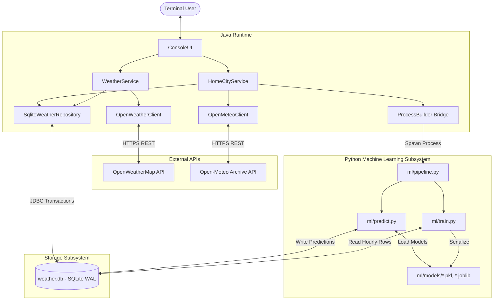
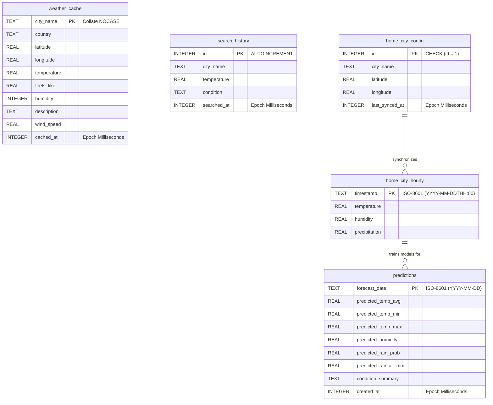
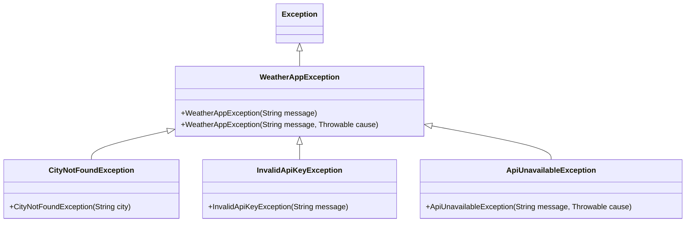

# 🏛️ System Architecture Specification

> **Java CLI Weather & AI Climate Forecasting Workstation**  
> An enterprise-grade, polyglot terminal workstation bridging high-performance Java systems with Python statistical machine learning.

---

## 📑 Table of Contents

- [1. Executive Architectural Overview](#1-executive-architectural-overview)
  - [1.1 Core Architectural Principles](#11-core-architectural-principles)
  - [1.2 High-Level System Topology](#12-high-level-system-topology)
- [2. Java Subsystem Architecture](#2-java-subsystem-architecture)
  - [2.1 Presentation Layer (`ConsoleUI`)](#21-presentation-layer-consoleui)
  - [2.2 Service & Orchestration Layer](#22-service--orchestration-layer)
  - [2.3 Domain Model Layer (Java 25 Records)](#23-domain-model-layer-java-25-records)
  - [2.4 Persistence & Data Access Layer (`SqliteWeatherRepository`)](#24-persistence--data-access-layer-sqliteweatherrepository)
  - [2.5 External Integration Layer (`OpenWeatherClient` & `OpenMeteoClient`)](#25-external-integration-layer-openweatherclient--openmeteoclient)
- [3. Machine Learning Subsystem Architecture](#3-machine-learning-subsystem-architecture)
  - [3.1 Multi-Variate Ensemble Architecture](#31-multi-variate-ensemble-architecture)
  - [3.2 Feature Engineering & Cyclical Encodings](#32-feature-engineering--cyclical-encodings)
  - [3.3 Intelligent Condition Synthesis Engine](#33-intelligent-condition-synthesis-engine)
- [4. Data Architecture & Database Design](#4-data-architecture--database-design)
  - [4.1 Entity-Relationship (ER) Schema](#41-entity-relationship-er-schema)
  - [4.2 Detailed Table Specifications](#42-detailed-table-specifications)
  - [4.3 Concurrency & Write-Ahead Logging (WAL Mode)](#43-concurrency--write-ahead-logging-wal-mode)
  - [4.4 High-Performance Transaction Batching](#44-high-performance-transaction-batching)
- [5. Polyglot Inter-Process Communication (IPC) Bridge](#5-polyglot-inter-process-communication-ipc-bridge)
  - [5.1 Invocation Protocol & Executable Resolution](#51-invocation-protocol--executable-resolution)
  - [5.2 Deadlock-Free Stream Consumption Pattern](#52-deadlock-free-stream-consumption-pattern)
  - [5.3 SQLite as the Polyglot Data Exchange Medium](#53-sqlite-as-the-polyglot-data-exchange-medium)
- [6. Error Handling & Resilience Strategy](#6-error-handling--resilience-strategy)
  - [6.1 Exception Class Hierarchy](#61-exception-class-hierarchy)
  - [6.2 Graceful Degradation Matrix](#62-graceful-degradation-matrix)
- [7. Security & Operational Reliability](#7-security--operational-reliability)
  - [7.1 Zero-Leak Credential Management](#71-zero-leak-credential-management)
  - [7.2 SQL Injection Immunity](#72-sql-injection-immunity)
  - [7.3 Hermetic Testing Strategy](#73-hermetic-testing-strategy)

---

## 1. Executive Architectural Overview

The workstation integrates two fundamentally different computing ecosystems into a unified, zero-latency desktop product:
1. **Java 25 (Enterprise Core)**: Handles robust networking, modern Java runtime features, database transactions, UI formatting, and lifecycle orchestration.
2. **Python 3.11–3.13 (Scientific & ML Engine)**: Handles statistical time-series forecasting (Facebook Prophet) and ensemble classification/regression (Scikit-Learn).

```
                      ┌──────────────────────────────────────────┐
                      │              USER / TERMINAL             │
                      └────────────────────┬─────────────────────┘
                                           │ ANSI / UTF-8
                                           ▼
┌────────────────────────────────────────────────────────────────────────────────────────┐
│                                   JAVA 25 SUBSYSTEM                                    │
│                                                                                        │
│   ┌────────────────────────────────────────────────────────────────────────────────┐   │
│   │                      ConsoleUI (Presentation / Layout Engine)                  │   │
│   └──────────────────────┬──────────────────────────────────┬──────────────────────┘   │
│                          │                                  │                          │
│                          ▼                                  ▼                          │
│   ┌───────────────────────────────┐      ┌─────────────────────────────────────────┐   │
│   │        WeatherService         │      │             HomeCityService             │   │
│   │    (Cache Orchestration &     │      │      (Geocoding, 10-Yr Sync &           │   │
│   │     Search History Queue)     │      │        Python Process Control)          │   │
│   └───────┬──────────────┬────────┘      └────────┬───────────┬─────────────┬──────┘   │
│           │              │                        │           │             │          │
│           ▼              │                        │           ▼             │          │
│   ┌───────────────┐      │                        │    ┌──────────────┐     │          │
│   │  OpenWeather  │      │                        │    │  Open-Meteo  │     │          │
│   │  HTTP Client  │      │                        │    │  HTTP Client │     │          │
│   └───────┬───────┘      │                        │    └──────┬───────┘     │          │
│           │              │                        │           │             │          │
└───────────┼──────────────┼────────────────────────┼───────────┼─────────────┼──────────┘
            │ HTTPS        │ JDBC                   │ JDBC      │ HTTPS       │ ProcessBuilder
            ▼              ▼                        ▼           ▼             ▼
     ┌─────────────┐  ┌──────────────────────────────────┐ ┌─────────┐  ┌─────────────┐
     │ OpenWeather │  │      SQLite Database (WAL Mode)  │ │ Open-   │  │   Python    │
     │ Live API    │  │             weather.db           │ │ Meteo   │  │ ML Pipeline │
     └─────────────┘  └─────────────────▲────────────────┘ │ Archive │  └──────┬──────┘
                                        │                  │ API     │         │
                                        │ Read / Write     └─────────┘         │
                                        └──────────────────────────────────────┘
```

### 1.1 Core Architectural Principles

- **Clean Layered Architecture**: Strict dependency flow from UI → Service → Repository/Client. Higher layers depend on abstractions (`WeatherRepository`), never concrete implementations.
- **Offline-First & Resilient**: Live data queries are cached in SQLite with a 15-minute TTL. Historical datasets and ML models remain fully operational without an internet connection.
- **Zero-Serialization Inter-Process Communication**: Rather than passing large multi-megabyte JSON payloads over stdin/stdout or maintaining an HTTP microservice daemon, Java and Python communicate through an embedded **SQLite database running in WAL mode**.
- **Deep Immutability**: All domain representations are modeled as Java 25 `record` types, guaranteeing thread-safety, zero shared mutable state, and structural equality.
- **Graceful Degradation**: Network partitions, missing API keys, or machine learning errors are isolated and presented with recovery runbooks without crashing the application.

### 1.2 High-Level System Topology

> 💡 **Interactive Diagram Available**: Explore the standalone interactive runtime architecture map with light/dark themes and guided views at [docs/runtime-architecture.html](file:///d:/JAVA%20Project/docs/runtime-architecture.html).



---

## 2. Java Subsystem Architecture

### 2.1 Presentation Layer (`ConsoleUI`)

The terminal workstation implements an ANSI escape-sequenced interface designed for readability, high information density, and absolute visual consistency:

```
src/main/java/com/princeblue/weather/ui/
└── ConsoleUI.java
```

- **ANSI Terminal Styling**: Features dedicated color tokens (`CYAN`, `GREEN`, `YELLOW`, `RED`, `BLUE`, `GRAY`, `BOLD`, `RESET`) tailored to temperature ranges and data states.
- **Unicode Visual Width Calculation**: Standard `String.length()` counts UTF-16 code units, not visual terminal columns. Emojis (e.g. 🌧️, 🌡️, 💧) occupy 2 visual columns, while Unicode Variation Selectors (`\uFE0F`) occupy 0 columns. `ConsoleUI` includes an algorithmic `visualWidth()` engine:
  ```java
  private static int visualWidth(String str) {
      String plain = str.replaceAll("\u001B\\[[;\\d]*m", ""); // Strip ANSI
      int width = 0;
      for (int i = 0; i < plain.length(); i++) {
          char c = plain.charAt(i);
          if (c == '\uFE0F') continue;
          if (Character.isHighSurrogate(c)) { width += 2; i++; }
          else if ((c >= 0x2600 && c <= 0x27BF) || (c >= 0x2B50 && c <= 0x2B55)) { width += 2; }
          else { width += 1; }
      }
      return width;
  }
  ```
- **Responsive Padding & Box Layout**: Rows are dynamically padded against fixed visual targets (50 columns for Cards, 70 columns for Forecast and History Tables), ensuring pixel-perfect border alignment across any terminal emulator.
- **Non-Blocking Background Stream Consumption**: When executing ML training, UI spins a daemon thread to consume Python's `stdout` and updates the user with milestone indicators every 8 seconds.

### 2.2 Service & Orchestration Layer

Contains pure business logic, orchestration, and caching policies:

- **`WeatherService`**:
  - Serves as the caching facade between `ConsoleUI` and `OpenWeatherClient`.
  - Checks `SqliteWeatherRepository.getCachedWeather(cityName, 15)` (15-minute TTL).
  - On cache hit: returns cached weather immediately (zero HTTP network traffic).
  - On cache miss: invokes `OpenWeatherClient`, persists the new reading to cache, appends a record to `search_history`, and maintains the rolling history window.
- **`HomeCityService`**:
  - Orchestrates Home City geocoding via `OpenMeteoClient.geocodeCity(cityName)`.
  - Downloads 12 years of hourly historical climate data (~105,120 rows) and commits it to SQLite via batch transactions.
  - Resolves the Python environment path across Windows and POSIX systems (`findPythonExecutable()`).
  - Launches and supervises the Python ML process (`startAiPipelineProcess()`).

### 2.3 Domain Model Layer (Java 25 Records)

The domain is modeled entirely with immutable Java 25 `record` types:

| Record Name | Key Attributes | Responsibility |
| :--- | :--- | :--- |
| `Weather` | `Location`, `temp`, `feelsLike`, `humidity`, `description`, `windSpeed` | Represents snapshot of current atmospheric conditions |
| `Location` | `city`, `country`, `latitude`, `longitude` | Geographical coordinates and identity |
| `SearchRecord` | `id`, `cityName`, `temperature`, `condition`, `searchedAt` | Audit log entry for recent user searches |
| `HomeCityConfig` | `cityName`, `latitude`, `longitude`, `lastSyncedAt` | Singleton user workstation configuration |
| `HourlyWeatherRecord` | `timestamp`, `temperature`, `humidity`, `precipitation` | Normalized hourly climate data point |
| `WeatherPrediction` | `forecastDate`, `tempAvg`, `tempMin`, `tempMax`, `humidity`, `rainProb`, `rainfallMm`, `summary` | Multi-variate daily future forecast |

#### Advantages of Java 25 Records:
- **Zero Boilerplate**: Canonical constructor, accessors, `equals()`, `hashCode()`, and `toString()` are compiler-generated.
- **Immutability by Default**: Fields are `final`; records cannot be mutated after instantiation.
- **Pattern Matching Ready**: Compatible with Java 25 record deconstruction in switch statements and type tests.

### 2.4 Persistence & Data Access Layer (`SqliteWeatherRepository`)

```java
public interface WeatherRepository {
    Optional<Weather> getCachedWeather(String cityName, Duration maxAge);
    void saveCachedWeather(Weather weather);
    void recordSearch(String cityName, double temp, String condition);
    List<SearchRecord> getRecentSearches(int limit);
    void saveHomeCityConfig(HomeCityConfig config);
    Optional<HomeCityConfig> getHomeCityConfig();
    void saveHourlyWeatherBatch(List<HourlyWeatherRecord> records);
    int getHourlyRecordCount();
    List<WeatherPrediction> getPredictions(LocalDate fromDate);
    void clearCache();
}
```

- **Thread-Safe JDBC Implementation**: `SqliteWeatherRepository` uses direct JDBC drivers without heavy ORM overhead (Hibernate/JPA), minimizing memory footprint and startup latency.
- **Schema Auto-Migration**: Verifies table and column existence at startup and executes non-destructive `ALTER TABLE` migrations if newer columns are detected.

### 2.5 External Integration Layer (`OpenWeatherClient` & `OpenMeteoClient`)

- **Modern HTTP Engine**: Built on Java 11 `java.net.http.HttpClient` with configured connect timeouts (10 seconds) and automatic gzip decompression.
- **`OpenWeatherClient`**:
  - Communicates with `api.openweathermap.org/data/2.5/weather`.
  - Uses `Jackson ObjectMapper` for high-throughput JSON tree navigation.
  - Maps HTTP status codes into strongly-typed domain exceptions (401 → `InvalidApiKeyException`, 404 → `CityNotFoundException`, 429/5xx → `ApiUnavailableException`).
- **`OpenMeteoClient`**:
  - Communicates with Open-Meteo Geocoding (`geocoding-api.open-meteo.com`) and Archive (`archive-api.open-meteo.com`).
  - Requires **zero API keys**, allowing instant 12-year historical synchronization out-of-the-box.
  - Streams parallel arrays (`time`, `temperature_2m`, `relative_humidity_2m`, `precipitation`) and transforms them into strongly-typed `HourlyWeatherRecord` collections.

---

## 3. Machine Learning Subsystem Architecture

The ML subsystem is located in `ml/` and runs as an autonomous, self-contained pipeline:

```
ml/
├── config.py           # Hyperparameters, file paths, forecast horizons
├── db_utils.py         # SQLite connection pooling & schema migration
├── train.py            # Model training & artifact serialization
├── predict.py          # 7-day multi-variate projection & synthesis
└── pipeline.py         # Single-point orchestrator invoked by Java ProcessBuilder
```

### 3.1 Multi-Variate Ensemble Architecture

Forecasting weather requires modeling both continuous thermodynamic variables and discrete probabilistic events. The workstation deploys a **hybrid 4-model ensemble**:

```
                       ┌──────────────────────────────────────────────┐
                       │   SQLite: home_city_hourly (~105,120 rows)    │
                       └──────────────────────┬───────────────────────┘
                                              │
                     ┌────────────────────────┼────────────────────────┐
                     │                        │                        │
                     ▼                        ▼                        ▼
           ┌──────────────────┐     ┌──────────────────┐     ┌──────────────────┐
           │ Facebook Prophet │     │ Facebook Prophet │     │ Feature Extractor│
           │ Temperature Model│     │  Humidity Model  │     │ (DOY, Temp, Hum) │
           └─────────┬────────┘     └─────────┬────────┘     └─────────┬────────┘
                     │                        │                        │
                     │                        │                        ▼
                     │                        │              ┌──────────────────┐
                     │                        │              │ HistGradBoosting │
                     │                        │              │ Rain Classifier  │
                     │                        │              └─────────┬────────┘
                     │                        │                        │
                     │                        │                        ▼
                     │                        │              ┌──────────────────┐
                     │                        │              │ HistGradBoosting │
                     │                        │              │Rainfall Regressor│
                     │                        │              └─────────┬────────┘
                     │                        │                        │
                     └────────────────────────┼────────────────────────┘
                                              ▼
                             ┌──────────────────────────────────┐
                             │   Intelligent Weather Synthesis  │
                             │        (Condition Summary)       │
                             └────────────────┬─────────────────┘
                                              ▼
                             ┌──────────────────────────────────┐
                             │     SQLite: predictions Table    │
                             └──────────────────────────────────┘
```

1. **Temperature Forecast Engine (`Prophet`)**:
   - Model: Additive Generalized Additive Model (GAM):
     $$y(t) = g(t) + s(t) + h(t) + \epsilon_t$$
     where $g(t)$ is non-linear trend, $s(t)$ represents yearly and daily seasonality, and $\epsilon_t$ is normally distributed error.
   - Interval Width: 80% confidence interval (`yhat_lower`, `yhat_upper`).
   - Optimization: Subsampled to 2-hour increments for high training velocity (<10 seconds).
2. **Relative Humidity Forecast Engine (`Prophet`)**:
   - Models diurnal evaporation/condensation cycles and seasonal monsoon/dry patterns.
   - Subsampled to 3-hour increments.
3. **Rain Probability Classifier (`HistGradientBoostingClassifier`)**:
   - Evaluates non-linear thresholds where precipitation occurs ($P(\text{Rain} \ge 0.2\text{ mm})$).
   - Outputs calibrated probabilities from 0.0% to 100.0%.
4. **Precipitation Volume Regressor (`HistGradientBoostingRegressor`)**:
   - Trained conditionally on wet days ($\text{Precipitation} \ge 0.2\text{ mm}$).
   - Predicts expected rainfall volume in millimeters (mm).

### 3.2 Feature Engineering & Cyclical Encodings

Calendar day-of-year ($1 \dots 365$) is inherently cyclical: Day 365 and Day 1 are consecutive days, but standard linear models treat them as maximum distance apart. To preserve circular continuity, the feature pipeline applies **sinusoidal cyclical transforms**:

$$\sin_{\text{doy}} = \sin\left(\frac{2\pi \cdot \text{DOY}}{365.25}\right), \quad \cos_{\text{doy}} = \cos\left(\frac{2\pi \cdot \text{DOY}}{365.25}\right)$$

Each feature vector $X$ incorporates:
1. $\sin_{\text{doy}}$ (Seasonal solar angle)
2. $\cos_{\text{doy}}$ (Seasonal orbital position)
3. $\bar{T}_{\text{predicted}}$ (Predicted daily mean temperature from Prophet)
4. $\bar{H}_{\text{predicted}}$ (Predicted daily mean relative humidity from Prophet)

### 3.3 Intelligent Condition Synthesis Engine

`ml/predict.py` applies domain-specific meteorological rules to generate expressive weather summaries:

```text
Rain Probability ≥ 70% AND Rainfall ≥ 12mm  ➔  ⛈️ Heavy Rain
Rain Probability ≥ 70%                      ➔  🌧️ Rain Likely
Rain Probability ≥ 40%                      ➔  🌦️ Showers Likely
Rain Probability ≥ 20%                      ➔  ⛅ Chance of Rain
Rain Probability < 20%:
   ├── Humidity ≥ 85%                       ➔  🌫️ Humid / Misty
   ├── Temp ≥ 33°C                          ➔  ☀️ Hot & Sunny
   ├── Temp ≥ 26°C                          ➔  🌤️ Warm & Clear
   ├── Temp ≥ 20°C                          ➔  ⛅ Mild & Pleasant
   ├── Temp ≥ 14°C                          ➔  🌥️ Cool & Breezy
   └── Temp < 14°C                          ➔  ❄️ Chilly
```

---

## 4. Data Architecture & Database Design

### 4.1 Entity-Relationship (ER) Schema



### 4.2 Detailed Table Specifications

#### 1. `weather_cache`
- **Purpose**: Caches OpenWeatherMap live responses to minimize latency and honor API rate limits.
- **Primary Key**: `city_name` with `COLLATE NOCASE` (case-insensitive deduplication).
- **Eviction Strategy**: Checked on read against `cached_at + TTL (15 mins)`.

#### 2. `search_history`
- **Purpose**: Tracks recently queried cities.
- **Retention**: Capped at 30/35 records. When capacity is reached, oldest records (`id IN (SELECT id ORDER BY searched_at ASC LIMIT ...)`) are automatically pruned.

#### 3. `home_city_config`
- **Purpose**: Stores the user's primary workstation city and geocoordinates.
- **Design Pattern**: Singleton Row. Enforced via `CHECK (id = 1)`.

#### 4. `home_city_hourly`
- **Purpose**: 12 years of hourly historical climate data (~105,120 records).
- **Primary Key**: `timestamp` (ISO-8601 format: `2014-09-24T00:00`).

#### 5. `predictions`
- **Purpose**: Stores multi-variate daily forecasts produced by the Python pipeline.
- **Primary Key**: `forecast_date` (`YYYY-MM-DD`). Allows atomic upserts via `INSERT OR REPLACE INTO predictions ...`.

### 4.3 Concurrency & Write-Ahead Logging (WAL Mode)

Standard SQLite locks the entire database file during write transactions, causing `SQLITE_BUSY` errors when multiple processes access the file.

The application explicitly executes:
```sql
PRAGMA journal_mode = WAL;
```
**Why WAL Mode is Essential**:
1. **Readers Never Block Writers**: Java can query `predictions` or `weather_cache` while Python writes to `predictions`.
2. **Writers Never Block Readers**: Python can insert 105,120 historical rows while Java reads current search history.
3. **High Write Throughput**: Writes are appended sequentially to the `-wal` file rather than rewriting database pages in place.

### 4.4 High-Performance Transaction Batching

Inserting 105,120 records with autocommit requires 105,120 discrete disk syncs (taking over 60 seconds). `SqliteWeatherRepository` disables autocommit and wraps the entire sync in a single transaction:

```java
conn.setAutoCommit(false);
try (PreparedStatement pstmt = conn.prepareStatement(sql)) {
    for (HourlyWeatherRecord record : records) {
        pstmt.setString(1, record.timestamp());
        pstmt.setDouble(2, record.temperature());
        pstmt.setDouble(3, record.humidity());
        pstmt.setDouble(4, record.precipitation());
        pstmt.addBatch();
    }
    pstmt.executeBatch();
    conn.commit();
}
```
**Result**: 105,120 records are persisted in **under 2.5 seconds**.

---

## 5. Polyglot Inter-Process Communication (IPC) Bridge

### 5.1 Invocation Protocol & Executable Resolution

The bridge utilizes Java's `ProcessBuilder` to invoke `ml/pipeline.py`. To eliminate manual environment setup for users, `HomeCityService.findPythonExecutable()` implements an intelligent search heuristic:

```text
1. Check ml/.venv/Scripts/python.exe (Windows Virtualenv) ───► Found? Use it!
2. Check ml/.venv/bin/python         (POSIX Virtualenv)   ───► Found? Use it!
3. Fallback to system "python" on PATH                    ───► Last resort
```

### 5.2 Deadlock-Free Stream Consumption Pattern

A common anti-pattern in Java `ProcessBuilder` usage is calling `process.waitFor()` without draining standard output. If the child process generates more than 64 KB of output, the operating system pipe buffer fills up, causing a permanent deadlock.

The workstation eliminates deadlocks through a **daemon drain thread**:

```java
ProcessBuilder pb = new ProcessBuilder(pythonExe, "ml/pipeline.py");
pb.redirectErrorStream(true); // Merge stderr into stdout
Process process = pb.start();

// Spawn asynchronous consumer thread
StringBuilder outputLog = new StringBuilder();
Thread readerThread = new Thread(() -> {
    try (BufferedReader reader = new BufferedReader(
            new InputStreamReader(process.getInputStream(), StandardCharsets.UTF_8))) {
        String line;
        while ((line = reader.readLine()) != null) {
            outputLog.append(line).append("\n");
        }
    } catch (IOException ignored) {}
});
readerThread.setDaemon(true);
readerThread.start();

// Parent thread polls status with UI milestone ticks
while (process.isAlive()) {
    Thread.sleep(500);
}
int exitCode = process.waitFor();
```

### 5.3 SQLite as the Polyglot Data Exchange Medium

| Alternative Considered | Drawback | Why SQLite was Chosen |
| :--- | :--- | :--- |
| **REST / HTTP Microservice** | High RAM overhead; requires managing long-running background daemon; port collision risks. | Embedded, zero daemon management, zero memory when inactive. |
| **JSON over Stdin / Stdout** | High CPU overhead serializing/deserializing 105,120 records; susceptible to encoding glitches. | Zero serialization overhead; direct C-level SQLite query execution in both runtimes. |
| **Unix Domain Sockets** | Inconsistent support on legacy Windows environments. | 100% cross-platform standard file format. |

---

## 6. Error Handling & Resilience Strategy

### 6.1 Exception Class Hierarchy



- `WeatherAppException`: Root unchecked domain exception.
- `CityNotFoundException`: Raised on HTTP 404; prompts user to check spelling or add country code.
- `InvalidApiKeyException`: Raised on HTTP 401; directs user to `config.properties`.
- `ApiUnavailableException`: Raised on HTTP 429/5xx or network dropouts.

### 6.2 Graceful Degradation Matrix

| Failure Mode | Direct Impact | System Fallback Behavior |
| :--- | :--- | :--- |
| **Internet Disconnected** | Live API fails | Serves existing entries from SQLite cache; Home City 7-day AI forecast remains fully accessible offline. |
| **Invalid OpenWeather Key** | Search fails | Home City 12-year historical sync and AI forecasting continue working (Open-Meteo requires no key). |
| **Python Not Installed** | AI training fails | CLI remains fully operational for live weather and search history; outputs actionable guidance to install Python. |
| **Model Files Corrupted** | Prediction generation fails | Database retains historical data; user prompted to trigger Option 2 (Retrain AI) to regenerate clean weights. |

---

## 7. Security & Operational Reliability

### 7.1 Zero-Leak Credential Management
- `config.properties` is strictly ignored by Git.
- `config.properties.example` is tracked, containing safe placeholder values.
- SQLite `.db`, `-wal`, and `-shm` files are excluded from source control.

### 7.2 SQL Injection Immunity
Every database query in both Java and Python utilizes **parameterized prepared statements** (`?` placeholders). No user-supplied string is ever concatenated directly into SQL syntax.

### 7.3 Hermetic Testing Strategy
The test suite consists of **31 JUnit 5 tests** across clients, models, repositories, and UI:
- **Zero Network Flakiness**: `OpenWeatherClientTest` and `OpenMeteoClientTest` run against simulated HTTP responses or mocks.
- **Isolated Databases**: Repository tests run against temporary, ephemeral SQLite instances.
- **Deterministic**: Tests pass in offline environments without external credentials.
